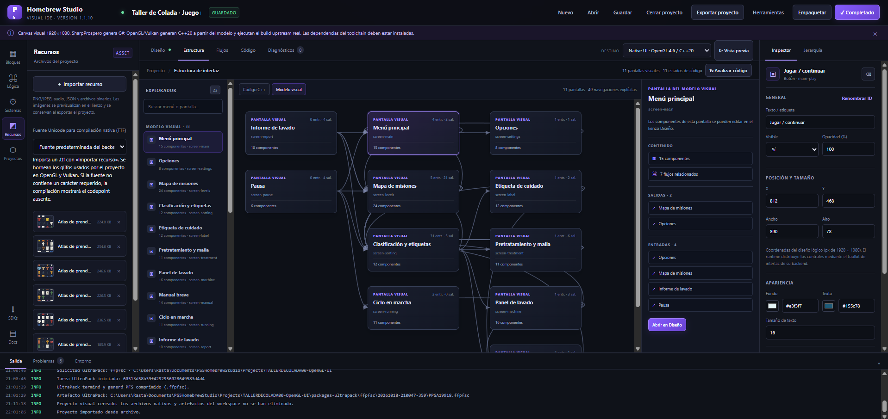

# PS5 Homebrew Studio

<p align="center">
  
</p>

**Release 1.1.10 · IDE visual local para Windows.** Integra un editor visual 1920×1080, análisis de flujos, generación de código C# para SharpProspero y conversión del modelo visual a pantallas C++20 para los kits nativos OpenGL/Vulkan. Incluye un catálogo verificado por función de boilerplates, UI kits, drivers, complementos gráficos y aplicaciones comunitarias de referencia.

## Runtime nativo autónomo · 1.1.10

- Los títulos visuales OpenGL aplican un perfil de runtime propio del IDE. El framework upstream aporta el renderer y los componentes gráficos, pero su shell de galería deja de controlar el título generado.
- L1, R1 y Touchpad no se reservan para cambiar de diseño ni abrir un panel informativo. El InputFrame llega a la pantalla generada sin filtrado; si el código generado no implementa una acción, esos botones no hacen nada.
- El perfil se registra en .ps5hs-native-runtime.json, es idempotente y falla de forma segura si la estructura upstream cambia.
- Se aplica al generar un título y al compilar proyectos visuales OpenGL anteriores reconocibles; no altera proyectos de galería importados que no proceden del lienzo de Homebrew Studio.
- Vulkan conserva su pantalla directa; mantener OPTIONS para salir sigue siendo el comportamiento documentado de la plantilla.

## Capas y lienzo · 1.1.9

- Los proyectos visuales antiguos sin orden explícito colocan paneles y tarjetas al fondo en vez de ocultar el contenido.
- En **Jerarquía**, usa `◎` para aislar temporalmente cualquier capa y «Mostrar todas» para recuperar la composición. La selección no cambia el orden visual.
- El lienzo conserva la proporción 16:9 y se ajusta al área visible. Los recursos importados muestran su transparencia real cuando contienen un PNG.
- UltraPack muestra un estado de preparación distinto del inicio real del trabajo y registra el identificador de tarea.

## Fuentes Unicode para compilación nativa · 1.1.9

En **Recursos**, importa una fuente TrueType `.ttf` (máximo 20 MiB) y selecciónala en el control «Fuente Unicode para compilación nativa». Durante una compilación OpenGL/Vulkan, el servidor recopila los codepoints del modelo y hornea seis atlas SDF. Si la fuente no contiene un glifo requerido, la compilación falla con su codepoint en vez de emitir un título con texto incompleto. El máximo es de 2.500 codepoints únicos; confirma la licencia de la fuente antes de redistribuir el título. Esta función no añade shaping completo ni un IME multilingüe a la entrada en pantalla.

## Nueva vista Estructura · 1.1.6

- La pestaña **Estructura** muestra por separado las pantallas editables del modelo visual y los estados de interfaz detectados en código C++.
- Permite buscar menús, consultar el mapa de transiciones, ver etiquetas encontradas y saltar a la declaración o función de dibujo correspondiente.
- El mapa de C++ se obtiene mediante análisis estático: las rutas inferidas deben comprobarse en el código y no convierten automáticamente un menú dibujado a mano en componentes editables.

## Corrección urgente 1.1.5

- Se arregla el selector de botones de los diálogos UltraPack y Presentación: ambos quedan operativos en lugar de fallar antes de ejecutar la acción.
- Se añade versionado a los scripts JavaScript para que el navegador cargue los archivos de la versión instalada.

## Correcciones y mejoras 1.1.4

- La generación OpenGL nativa ejecuta el `build.ps1` del propio proyecto y reutiliza su SDK local. Evita preparar otra copia del SDK en `toolchains/` antes de compilar y muestra la salida real del script.
- En el diálogo **Generar y compilar pantalla nativa** puedes seleccionar antes del build el icono (`icon0.png`), fondo de selección (`pic0.dds`), fondo de lanzamiento (`pic1.dds`) y música (`snd0.at9`). Los conversores y validaciones siguen siendo los de la plantilla upstream.
- El selector **Pantallas** permite crear y cambiar entre menús. **Gestionar** permite renombrar o eliminar pantallas; la pestaña **Jerarquía** muestra las capas de la pantalla activa y permite traerlas delante, enviarlas detrás o arrastrarlas para reordenarlas.

## Inicio en Windows

1. Extrae el ZIP en una carpeta con permisos de escritura, por ejemplo `D:\PS5-Homebrew-Studio`.
2. Ejecuta `start.bat`. El lanzador prefiere PowerShell 7 (`pwsh.exe`) y usa Windows PowerShell 5.1 solo como alternativa.
3. El lanzador analiza `runtime/server.ps1` con el parser de PowerShell antes de iniciar el servicio. Si detecta un error, muestra línea/columna y no arranca el servidor.
4. Se abre `http://127.0.0.1:47813/`. Mantén abierta la ventana de PowerShell; cerrarla detiene el servicio.

El servicio escucha únicamente en `127.0.0.1`; no expone el sistema de archivos a la red local. Los proyectos del editor se guardan en `Documentos\PS5HomebrewStudio\Projects`. `Ctrl+S` guarda el modelo visual. El editor puede abrirse y usarse sin descargar ningún toolchain.

## Documentación 1.1.10

- Manual español: [docs/MANUAL.es-ES.md](docs/MANUAL.es-ES.md)
- English: [docs/USER-MANUAL.en-GB.md](docs/USER-MANUAL.en-GB.md)
- Français: [docs/USER-MANUAL.fr-FR.md](docs/USER-MANUAL.fr-FR.md)
- Deutsch: [docs/USER-MANUAL.de-DE.md](docs/USER-MANUAL.de-DE.md)
- 简体中文: [docs/USER-MANUAL.zh-CN.md](docs/USER-MANUAL.zh-CN.md)
- 日本語: [docs/USER-MANUAL.ja-JP.md](docs/USER-MANUAL.ja-JP.md)
- Русский: [docs/USER-MANUAL.ru-RU.md](docs/USER-MANUAL.ru-RU.md)
- [Solución de permisos WSL](docs/WSL_PERMISSIONS.md) · [Guía de recursos de presentación](docs/PRESENTATION_ASSETS.md) · [Créditos y atribuciones upstream](docs/CREDITS.md)
- [Ecosistema de proyectos upstream](docs/PROJECT_ECOSYSTEM.md) · [Matriz de SDK](docs/SDK_MATRIX.md) · [Registro de cambios](docs/CHANGELOG.md)
- [Problemas conocidos y estado de validación 1.1.9](docs/KNOWN-ISSUES.es-ES.md)
- Fuentes Unicode: [guía en español](docs/UNICODE-FONTS.es-ES.md) · [English guide](docs/UNICODE-FONTS.en-GB.md)

La UI de esta versión todavía está en español; los manuales traducidos no representan una localización completa de la interfaz.

## Mejoras de desarrollo 1.1.2 (histórico)

- Los títulos nativos incluyen **Presentación** para sustituir `icon0.png`, los fondos independientes `pic0.dds`/`pic1.dds` y la música `snd0.at9` mediante el conversor upstream.
- Las imágenes se validan como PNG 512×512 o DDS BC7 3840×2160; el audio debe ser ATRAC9 48 kHz en bucle y ≤2 MiB. El IDE no descarga ni redistribuye el codificador de audio.
- Guía: [recursos de presentación](docs/PRESENTATION_ASSETS.md).

## Mejoras de desarrollo 1.1.1

- El panel de proyectos detecta checkouts Git existentes, proyectos nativos y plantillas Vulkan, muestra el perfil de compilación y separa títulos compilables de SDKs, drivers y referencias.
- Las plantillas compatibles pueden inicializarse mediante `tools/init-project.sh` o `make init`; los proyectos sin perfil seguro muestran el motivo y no ejecutan un `make` genérico.
- La compilación OpenGL prepara Native App Boilerplate y PS5 OpenGL, compila el SDK si falta y configura `PS5_NATIVE_APP_TEMPLATE` y `PS5_OPENGL_PREFIX`.
- El formulario de compilación permite ejecutar `make clean` antes de `make`, pero solo si el Makefile declara el target; no se borran artefactos por conjetura. Vulkan conserva su pipeline upstream si no hay un clean validado.
- «Cerrar proyecto» descarga el modelo visual y deja el editor en blanco; ofrece guardar o descartar cambios y conserva las carpetas nativas, compilaciones y paquetes.
- Se conserva la invocación de UltraPack que funciona en el entorno probado; la interfaz no añade `--verify` automáticamente.

## Cambios de 1.1.0

- Se retiró la integración de lanzamiento mediante emulador para mantener el IDE centrado en títulos comprobables en hardware real.
- Se corrigieron los selectores de la interfaz que impedían iniciar las acciones de UltraPack.
- El empaquetado se ejecuta como trabajo independiente con registro consultable sin bloquear el servidor local.
- Se valida Python 3.10+, se mantiene compatibilidad de argumentos con PowerShell 5.1 y se verifica el artefacto final.
- La compilación nativa solo se considera lista para empaquetar cuando hay un `eboot.bin` y `sce_sys/param.json`.
- El backend Vulkan instala un runtime de búsqueda/carga de texturas incluso cuando el proyecto no incluye imágenes; el generador ya no emite funciones vacías.
- Los flujos con destinos, acciones o pantallas inexistentes se rechazan antes de generar C++.

## Cambios de 1.0.9

- Kyty recibe la ruta de `eboot.bin` explícita y registra los argumentos de lanzamiento.
- UltraPack se instala con un entorno Python aislado y dependencias CLI; se valida la ruta configurada.
- El empaquetado `.pkg` detecta la ausencia del helper nativo de Windows antes de iniciar.

## Cambios de 1.0.8

- La invocación de UltraPack usa argumentos sin ambigüedad de comillas, ejecuta desde la carpeta del CLI y registra el comando y las salidas estándar/error.

## Cambios de 1.0.7

- Las acciones Kyty/UltraPack persisten en la barra superior y recuerdan la última compilación nativa correcta.
- La lectura concurrente de los registros de compilación ya no interrumpe el seguimiento del build.
- Se puede cambiar el nombre del destino o autorizar la sustitución de un proyecto propio compatible.
- Los fallos de UltraPack incluyen salida, código de salida y estado del artefacto.

## Cambios de 1.0.6

- Compilaciones visuales y proyectos nativos C++ en segundo plano con registro real de WSL/Make/CMake/Ninja consultable durante el proceso.
- Estado final explícito y acciones post-compilación para KytyPS5 y UltraPack.
- Selector UltraPack para `.ffpfs`, `.ffpfsc` y `.pkg`; PKG puede tener limitaciones en Windows según upstream.
- Atlas tipográfico europeo OpenGL de 2048 px para conservar acentos españoles.

## Qué incluye 1.0.4

- Corrige la entrada de compilación Windows de los proyectos nativos: `build.ps1` ejecuta `make -C <proyecto> app` en WSL en lugar de invocar `tools/build.sh` directamente.
- Deja que el Makefile upstream aplique las rutas de inclusión `src/`, el SDK OpenGL, las bibliotecas y los import stubs predeterminados antes de compilar.
- Conserva la normalización de finales de línea y la verificación SHA-256 del runtime introducidas en 1.0.3.

- Corrige la generación de recursos visuales: elimina el uso de `.add()` sobre el mapa de IDs y conserva la detección de colisiones mediante `Map`.
- Normaliza a LF los scripts, Makefiles, fuentes nativos y manifiestos `.sha256` de cada proyecto nativo generado, antes de inicializarlo y antes de compilarlo en WSL.
- Añade `*.sha256 text eol=lf` a `.gitattributes` del proyecto generado y usa `core.autocrlf=false` al clonar fuentes para evitar que Windows cambie los finales de línea de manifiestos de integridad.
- La validación del hash de `libc.prx` permanece habilitada; no se omite ni se debilita la comprobación de integridad.

- Catálogo de 34 repositorios reales clasificados como bases, renderers, kits de UI, drivers, dependencias, complementos gráficos y aplicaciones de referencia. Los repositorios con asistencia de IA solo se etiquetan como tal cuando lo declaran explícitamente.
- Inicializadores upstream para Native App Boilerplate, PS5 Homebrew UI y PS5 Vulkan Template. El IDE conserva los repositorios originales, sus licencias y los scripts de compilación.
- Un generador nativo compartido que convierte las posiciones, dimensiones, estilos, controles y flujos del lienzo en una implementación de `hui::app::Concept`.
- Backend OpenGL 4.6: inyecta el concepto generado en `ps5-homebrew-ui`, activa el registro de la pantalla generada y ejecuta `make` del proyecto upstream. Las imágenes vinculadas se predecodifican en el navegador, se limitan a 512×512, se empaquetan como RGBA8 y se suben como texturas OpenGL en tiempo de ejecución (hasta 16 recursos únicos).
- Backend Vulkan/RADV: utiliza `PS5_VulkanTemplate` y su `new-title.py`, sustituye la pantalla del módulo UI fijado y ejecuta el build real mediante CMake/Ninja y los scripts de PS5_Vulkan/PS5_Mesa/PS5_PayloadSDK.
- La compilación solo se marca correcta si el proceso upstream termina con código cero y existe un `eboot.bin` o ZIP verificable. Los logs reales y la ruta del proyecto permanecen disponibles cuando el build falla.
- Reparación acotada de la cadena Vulkan: si la revisión de PS5_Vulkan descargada no contiene `tools/ninja-build.sh` o `tools/build-host-tools.sh` que el build referencia, el IDE restaura los scripts reales del boilerplate compañero y registra su hash y procedencia. No genera stubs vacíos.

## Empaquetado con PS5 UltraPack

La barra superior y las tarjetas de proyectos nativos ofrecen **Empaquetar** cuando el título se ha verificado con `eboot.bin` y `sce_sys/param.json`. En **Herramientas** se configura Python 3.10+ y la CLI `backend\\cli.py` de PS5 UltraPack. El IDE permite crear `.ffpfs`, `.ffpfsc` y `.pkg`; el último formato requiere el helper nativo de fPKG y sus dependencias para Windows. Los trabajos se ejecutan fuera del bucle HTTP principal y su salida se consulta desde el IDE. La configuración queda en `.runtime/integrations.json`. Consulta [la guía de UltraPack](docs/INTEGRACION-ULTRAPACK.es-ES.md).


La casilla **Verificar el contenido contra el origen** está activada por defecto y pasa `--verify` a UltraPack. La verificación puede requerir más tiempo y memoria. Si el log indica que se omitió o que se comprobaron cero hashes, no describas el resultado como una verificación íntegra del contenido. El mantenedor comunicó que un artefacto `.ffpfsc` concreto se generó y funcionó en hardware real; esto no garantiza compatibilidad universal.

## Editor visual y compilación

El editor ofrece lienzo 1920×1080, cuadrícula, arrastrar/soltar, propiedades, jerarquía, temas, pantallas, vista previa, lógica visual, diagnósticos, recursos, guardado, importación/exportación y código inspeccionable.

**SharpProspero · Aplicación** genera C# y utiliza su pipeline NativeAOT. Requiere .NET SDK 10 en Windows y dentro de WSL, además del SDK correspondiente. Los destinos payload/plugin que no son renderers no aceptan indebidamente código C# de interfaz.

**Native UI · OpenGL 4.6 / C++20** genera una pantalla basada en el contrato real de `ps5-homebrew-ui`. Conserva las coordenadas virtuales y los flujos `notify`, `setText`, `toggleVisibility`, `setValue`, `changeColor` y `navigate`. Los recursos de imagen vinculados se convierten a RGBA8 con un máximo de 512×512 píxeles y se empaquetan en el título; se cargan como texturas OpenGL (máximo 16 IDs únicos por pantalla).

**Native UI · Vulkan / RADV / C++20** genera una pantalla del contrato real del módulo `PS5_VKHomebrewUI`, dentro de un título creado por `PS5_VulkanTemplate`. Los componentes y los flujos funcionales se generan como C++; las imágenes se empaquetan como RGBA8, se registran en `ps5/assets.json` y se cargan mediante `VkRenderer::create_texture`. El paquete incluye una nota de licencia para recursos aportados por el usuario, que debe confirmar los derechos de redistribución.

En los dos backends C++ el `input` visual incluye un teclado en pantalla que se abre al confirmar: permite letras A–Z, números, puntuación básica, espacio, borrar, limpiar, aceptar y cancelar. Es un teclado ASCII propio del proyecto, no un IME multilingüe del sistema. Los demás controles con valor (interruptor, deslizador, incrementador, selector, carrusel/lista) responden a la cruceta y al botón de confirmación. Las pantallas múltiples se cambian mediante flujos de navegación; el shell conserva su control de salida.

La generación se ha probado con pruebas Node.js y la sintaxis del código C++ generado se ha comprobado con Clang contra interfaces de prueba compatibles. El entorno de preparación no dispone de PowerShell, .NET 10 ni un stack de toolchain PS5 completo: por ello **no afirmo haber ejecutado aquí el parser de PowerShell, el build real de PS5 ni una prueba en consola**. Al iniciar en Windows, `start.bat` ejecuta `runtime/check-syntax.ps1` para usar el parser oficial de PowerShell antes de lanzar el servidor.

## Pruebas locales del generador

Si tienes Node.js, ejecuta desde la carpeta del proyecto:

```powershell
node --check app.js
node --check runtime/native-generator.js
node runtime/test-native-generator.js
```

`test-native-generator.js` comprueba los dos backends, literales escapados, múltiples pantallas, componentes y flujos. El build real sigue requiriendo la cadena upstream indicada en cada plantilla. La primera compilación Vulkan puede ser pesada porque construye RADV desde los fuentes fijados.

## Requisitos y licencias

- OpenGL: Windows + WSL/Linux, Git, Make, Clang/LLD, dependencias de `ps5-homebrew-ui` y el SDK `ps5-opengl` que prepara el upstream.
- Vulkan: WSL/Linux, Git/submódulos, CMake/Ninja, Clang/LLVM, Meson, rsync, PS5_Vulkan, PS5_Mesa y la revisión fijada de PS5_PayloadSDK.
- Los títulos generados integran kits que mantienen licencias GPL. Revisa `LICENSE`, `THIRD_PARTY_NOTICES.md` y las licencias de cada recurso antes de redistribuir. No se incluyen firmware de PS5, claves, ROMs, BIOS, datos de juegos ni binarios propietarios de Sony/NVIDIA.
- El IDE solo escucha en `127.0.0.1`. El workspace se guarda en `Documentos\PS5HomebrewStudio\Projects`; las toolchains quedan en la carpeta del proyecto IDE.

## Ecosistema investigado

### Bases y SDKs

- [SharpProspero](https://github.com/SvenGDK/SharpProspero): aplicaciones nativas, bibliotecas y payloads C#.
- [PS5 Native App Boilerplate](https://github.com/blackbearreloaded/ps5-native-app-boilerplate): base C++20, runtime shim reproducible y empaquetado de título.
- [PS5 Vulkan Template](https://github.com/mihawk-99/PS5_VulkanTemplate): generador C++, muestras Vulkan y UI opcional.
- [PS5SDK](https://github.com/PS5Dev/PS5SDK): orientado principalmente a payload ELF y homebrew sencillo; upstream indica que todavía no genera títulos completos.
- [ps5-payload-dev/sdk](https://github.com/ps5-payload-dev/sdk): toolchain de payloads C/C++ y enlace dinámico.
- [ps5link-sdk](https://github.com/Rufidj/ps5link-sdk): enlazador de títulos nativos, con dependencias adicionales.
- [etaHEN-Plugins](https://github.com/etaHEN/etaHEN-Plugins): plugins/daemons de etaHEN, no aplicaciones GUI independientes.

### Gráficos y UI

- [PS5 OpenGL 4.6](https://github.com/blackbearreloaded/ps5-opengl) y su [kit de UI](https://github.com/blackbearreloaded/ps5-homebrew-ui).
- [PS5 Vulkan Template](https://github.com/mihawk-99/PS5_VulkanTemplate), [PS5_Vulkan](https://github.com/mihawk-99/PS5_Vulkan), [PS5_Mesa](https://github.com/mihawk-99/PS5_Mesa) y [PS5 VKHomebrewUI](https://github.com/mihawk-99/PS5_VKHomebrewUI).
- [PS5 OpenGL de mihawk-99](https://github.com/mihawk-99/ps5-opengl), [ps5gl](https://github.com/Rufidj/ps5gl) y [ps5-vulkan alternativo](https://github.com/mpereiraesaa/ps5-vulkan): proyectos diferentes, con niveles de compatibilidad distintos.
- [Aurora](https://github.com/encounter/aurora): capa GX/WebGPU con SDL3, backends multiplataforma y UI; los ports de PS5 le añaden una capa de plataforma.
- [PS5 FSR4](https://github.com/blackbearreloaded/ps5-fsr4) y [PS5 HelixSR](https://github.com/blackbearreloaded/ps5-helixsr): complementos experimentales de Vulkan compute que exigen revisar licencias, requisitos y procedencia de sus dependencias.

### Aplicaciones reales de referencia

Incluye [ProsperoLight](https://github.com/blackbearreloaded/ProsperoLight), [Unofficial Stremio PS5 Port](https://github.com/Sp9nky/unofficial-stremio-ps5-port), [Nativehbl](https://github.com/Rufidj/Nativehbl), [Quake3e PS5](https://github.com/griches/PS5_Quake3e), [Ghostship](https://github.com/griches/PS5_Ghostship), [SwitchWaker](https://github.com/griches/PS5_SwitchWaker), [Dusklight](https://github.com/griches/PS5_Dusklight), [Sunshine](https://github.com/griches/PS5_Sunshine), [Porpoise/Dolphin](https://github.com/elripalda/Porpoise-Dolphin-Emulator-for-PS5), [PS5 RetroArch](https://github.com/mihawk-99/PS5_RetroArch), [PS5X360](https://github.com/BrinooTk/PS5X360) y [Syobon Action PS5](https://github.com/kvaps/syobon-action-ps5).

Consulta [la matriz de SDKs](docs/SDK_MATRIX.md), [el estudio del ecosistema](docs/PROJECT_ECOSYSTEM.md) y la guía de [generación visual OpenGL/Vulkan](docs/NATIVE_VISUAL_BACKENDS.md) para saber qué es una base, un renderer, un driver, cómo se genera el código y qué limitaciones conserva cada backend. Un repositorio de aplicación completa puede aportar patrones arquitectónicos, pero no es necesariamente reutilizable sin portar dependencias, verificar licencia y resolver diferencias de firmware.

## Procedencia de IA

La etiqueta **IA declarada** está reservada a declaraciones explícitas. Por ejemplo, [ProsperoEden0](https://github.com/Tiang-88/ProsperoEden0) declara asistencia de herramientas OpenAI/Anthropic; [X360PS5 de polarco](https://github.com/polarco/X360PS5) documenta uso activo de Codex, pero el propio README indica que no se ha probado en una PS5 y que aún no carga juegos Xbox 360. Estos casos son evidencia de asistencia declarada, no garantía de calidad o compatibilidad. Los proyectos con `AGENTS.md`/`CLAUDE.md` no se etiquetan automáticamente como generados por IA.

## Licencias, dependencias y artefactos externos

- Cada fuente conserva su repositorio y avisos upstream; revisa `LICENSE`, `THIRD_PARTY_NOTICES.md` y licencias de subcomponentes antes de redistribuir.
- No se incluye firmware PS5, llaves de Sony, `libc.prx` propietario, ROMs, BIOS, datos de juegos ni binarios de NVIDIA. Si un repositorio requiere recursos que el usuario debe aportar, el IDE lo indica en su ficha.
- Clonar un repositorio no instala sus herramientas del sistema, ni garantiza que sus submódulos/dependencias puedan compilar en el equipo.
- La compatibilidad depende del firmware, loader, stack gráfico y las dependencias exactas. Los resultados de pruebas y limitaciones se toman de los documentos upstream; no se extrapolan a todas las consolas.

## Archivos importantes

- `start.bat`: comprueba sintaxis e inicia el IDE.
- `runtime/server.ps1`: servidor loopback, gestor de fuentes, materializador RGBA y build providers de SharpProspero, Homebrew UI y Vulkan Template.
- `runtime/native-generator.js`: generador C++20 para el contrato Concept del kit UI upstream.
- `runtime/test-native-generator.js`: pruebas automatizadas del generador y de las rutas OpenGL/Vulkan.
- `runtime/check-syntax.ps1`: usa el parser de PowerShell disponible en Windows y muestra línea/columna de errores.
- `index.html`, `styles.css`, `app.js`: editor visual y catálogo.
- `docs/SDK_MATRIX.md`, `docs/PROJECT_ECOSYSTEM.md`: investigación técnica.

**Validación de esta release:** pasan `node --check app.js`, `node --check runtime/layer-model.js`, `runtime/test-layer-model.js`, `runtime/test-native-generator.js` y `runtime/test-structure-explorer.js`. No se pudo ejecutar el parser oficial de PowerShell, una compilación C++20 real de PPSA19918 ni un empaquetado UltraPack de extremo a extremo porque esas herramientas no están disponibles en el entorno de preparación. Consulta `docs/KNOWN-ISSUES.es-ES.md` para separar las pruebas locales de las validaciones pendientes en Windows/WSL.


## Corrección 1.0.1

Corrige un error de parseo de PowerShell en la generación del README de proyecto: se delimita `${sourceName}` explícitamente en la cadena que produce `SaveProject`. Consulta `docs/patches/FIX-POWERSHELL-627.es-ES.md`.
